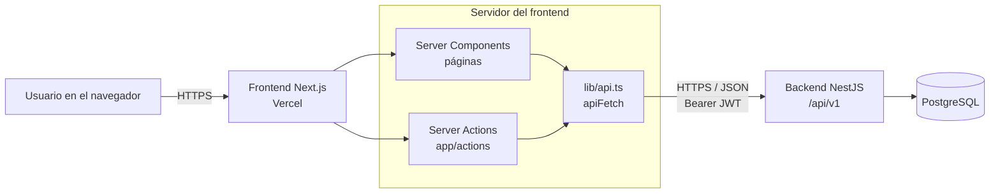

# Arquitectura

## Vista general



El navegador nunca habla con la API: las páginas (Server Components) y los
formularios (Server Actions) llaman al backend desde el servidor de Next.js con
`apiFetch`, que agrega el JWT guardado en una cookie httpOnly. Ante un 401 la
sesión se borra y se redirige a `/login`. La arquitectura del backend y la base
de datos están en la
[documentación del backend](https://github.com/david-galdamez/gestion_condominios_backend_fresquitop/blob/develop/docs/02-arquitectura.md).

## Stack

| Capa | Tecnología | Versión |
|---|---|---|
| Framework | Next.js (App Router, Server Actions) | 16.3 |
| UI | React + Tailwind CSS | 19.2 / 4 |
| Estado en el cliente | Zustand (usuario de la sesión) | 5 |
| Lenguaje | TypeScript | 5 |
| Pruebas | Vitest + Testing Library + jsdom | 5 / 16 |
| Backend | NestJS (repositorio aparte) | 12 |

## Estructura de carpetas

```
gestion_condominios_frontend_fresquitop
├── app/
│   ├── login/                 # pantalla pública de inicio de sesión
│   ├── (privado)/             # rutas con sesión; layout con menú por rol
│   │   ├── estado-cuenta/     # H01
│   │   ├── visitas/           # H07, H07b (lista, nueva, [id]/editar)
│   │   ├── reportes/          # H05
│   │   ├── porteria/paquetes/ # H09
│   │   └── admin/             # areas (H03), morosidad (H22), comunicados (H13)
│   ├── actions/               # Server Actions: validan y llaman a lib/*
│   └── api/                   # Route Handlers (sesión expirada, fotos de reportes)
├── components/                # componentes compartidos (badges, copiar)
├── lib/
│   ├── api.ts                 # fetch autenticado contra el backend
│   ├── session.ts, auth.ts    # cookies de sesión y requireRol()
│   ├── <modulo>.ts            # cliente de cada recurso con resultado discriminado
│   ├── validaciones/          # validadores puros compartidos cliente/servidor
│   └── types/                 # tipos de la API
├── proxy.ts                   # redirige a /login si no hay cookie de sesión
└── docs/
```

## Decisiones técnicas

| Decisión | Alternativas consideradas | Motivo |
|---|---|---|
| Llamar a la API solo desde el servidor (Server Components y Server Actions) | Llamar desde el navegador con fetch | El JWT no queda expuesto al JavaScript del cliente y no hace falta CORS. |
| JWT en cookie httpOnly, `sameSite=lax`, `secure` en producción | localStorage | Protege el token de XSS. |
| Cada cliente de recurso devuelve un resultado discriminado (`ok`, `bad_request`, `forbidden`, `not_found`, `conflict`, `error`) | Lanzar excepciones | Las páginas muestran el mensaje exacto de cada caso sin `try/catch` repetidos. |
| Validadores puros en `lib/validaciones` usados en el formulario y en la Server Action | Validar solo en el cliente | Mismos mensajes en ambos lados y nunca se confía en el cliente. |
| Campos controlados en formularios con `useActionState` | Formularios no controlados | React 19 reinicia los no controlados tras una acción y el usuario perdería lo escrito. |
| Fechas de negocio calculadas en America/El_Salvador en el servidor | Usar la zona del navegador | Los rangos (hoy a 30 días, “ahora”) no dependen del equipo del usuario. |
